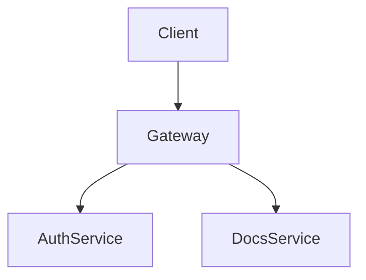

# Markdown & Code Formatting

Fumadocs enhances MDX with Shiki syntax highlighting, multi-tab codeblocks, type hovers, diagrams, and mathematical notation.

## Codeblocks & Shiki Features

### 1. Titles and Language Tags

Add a file title to display a header bar above the codeblock:

````mdx
```ts title="lib/auth.ts"
export const sessionTimeout = 3600;
```
````

### 2. Line Numbers

Enable line numbering with `lineNumbers`. Pass a number to specify an initial offset:

````mdx
```ts lineNumbers
const user = await getUser();
console.log(user);
```

```ts lineNumbers=24
export function restartServer() {
  process.exit(0);
}
```
````

### 3. Shiki Comment Annotations

Decorate individual lines or tokens using comment directives:

````mdx
```tsx
// Highlight a single line:
const token = generateToken(); // [!code highlight]

// Diff style additions and deletions:
const legacyAuth = true; // [!code --]
const modernAuth = true; // [!code ++]

// Focus attention on critical logic:
function executeCriticalTask() { // [!code focus]
  return execute();              // [!code focus]
}

// Highlight all occurrences of a specific word:
// [!code word:apiKey]
const apiKey = process.env.API_KEY;
validate(apiKey);
```
````

### 4. Code Tabs

Adjacent code blocks with `tab` attributes automatically render inside a tabbed switcher:

````mdx
```ts tab="TypeScript" tab-group="lang-choice"
const greeting: string = "Hello World";
```

```js tab="JavaScript"
const greeting = "Hello World";
```
````

Adding `tab-group="group-id"` synchronizes tab selection across multiple codeblocks on the page.

### 5. Package Manager Install Blocks

Use the `npm` or `package-install` language tag to generate interactive install tabs for `npm`, `pnpm`, `yarn`, and `bun` automatically:

````mdx
```npm
npm install fumadocs-core fumadocs-ui
```
````

---

## Twoslash Type Inspection

Twoslash displays interactive TypeScript type popovers and compile diagnostics directly within docs codeblocks.

### Setup

```bash
npm install fumadocs-twoslash twoslash
```

Externalize `typescript` and `twoslash` in `next.config.mjs`:

```js title="next.config.mjs"
const config = {
  reactStrictMode: true,
  serverExternalPackages: ['typescript', 'twoslash'],
};
```

Enable the Twoslash plugin in `source.config.ts`:

```ts title="source.config.ts"
import { defineConfig } from 'fumadocs-mdx/config';
import { rehypeCodeDefaultOptions } from 'fumadocs-core/mdx-plugins';
import { transformerTwoslash } from 'fumadocs-twoslash';

export default defineConfig({
  mdxOptions: {
    rehypeCodeOptions: {
      transformers: [
        ...rehypeCodeDefaultOptions.transformers,
        transformerTwoslash(),
      ],
    },
  },
});
```

### Usage

Use the query directive `// ^?` to display type hovers:

````mdx
```ts twoslash
interface Config {
  port: number;
  host: string;
}

const serverConfig: Config = { port: 3000, host: 'localhost' };
//      ^?
```
````

---

## Heading & TOC Customization

Control table of contents generation and custom anchor slugs directly on headings:

```md
## Custom Anchor [#custom-anchor-slug]
Links to this heading resolve to `/page#custom-anchor-slug`.

## Hidden from TOC [!toc]
This heading renders in page text but will not appear in the right-hand table of contents.

## In TOC Only [toc]
This heading appears in the table of contents but is invisible in page content. Useful for indexing components rendered via React.
```

---

## Diagrams & Mathematics

### Mermaid Diagrams

Render sequence charts, state diagrams, and flowcharts directly in markdown:

````mdx

````

Enable Mermaid in `source.config.ts`:

```ts title="source.config.ts"
import { remarkMdxMermaid } from 'fumadocs-core/mdx-plugins';
import { defineConfig } from 'fumadocs-mdx/config';

export default defineConfig({
  mdxOptions: {
    remarkPlugins: [remarkMdxMermaid],
  },
});
```

### KaTeX Mathematics

Write mathematical expressions using LaTeX syntax:

```bash
npm install remark-math rehype-katex katex
```

Add CSS imports to `app/global.css`:
```css
@import 'katex/dist/katex.min.css';
```

In your MDX file:
```mdx
Inline equation: $E = mc^2$

Block equation:
```math
\int_{-\infty}^{\infty} e^{-x^2} dx = \sqrt{\pi}
```
```

---

## Content Reusability: `<include>`

Reuse shared MDX snippets across pages without code duplication:

```mdx title="content/docs/page.mdx"
<include>./shared/_prerequisites.mdx</include>
```

The referenced path is resolved relative to the calling MDX document.
